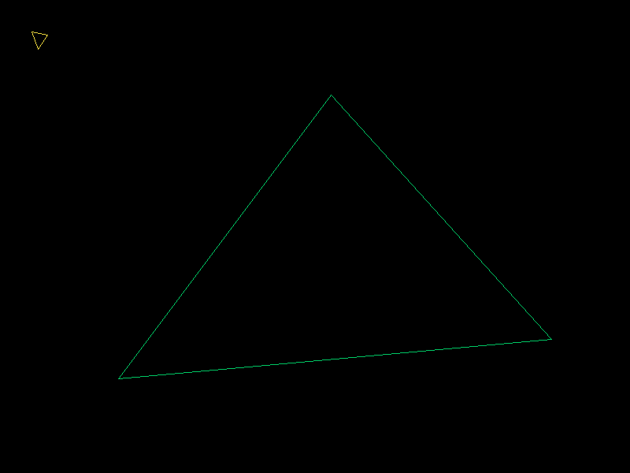
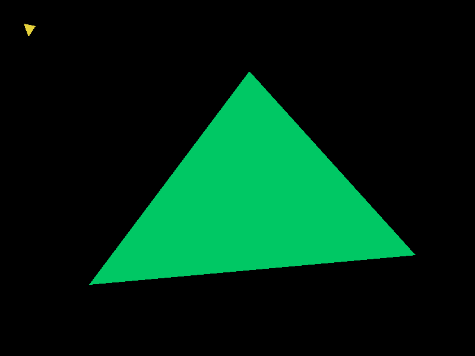
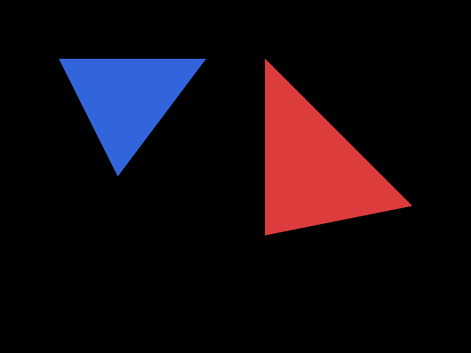
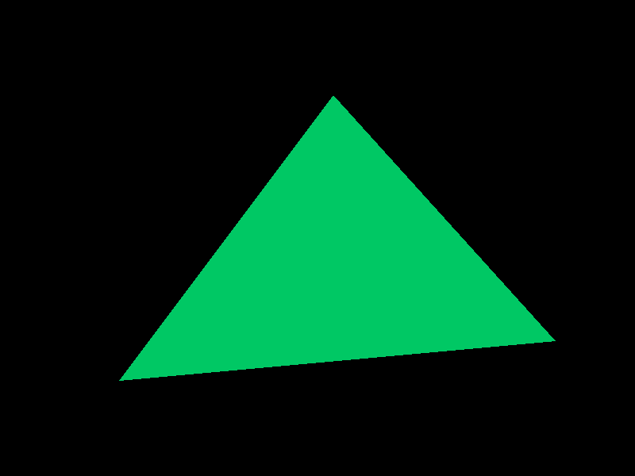
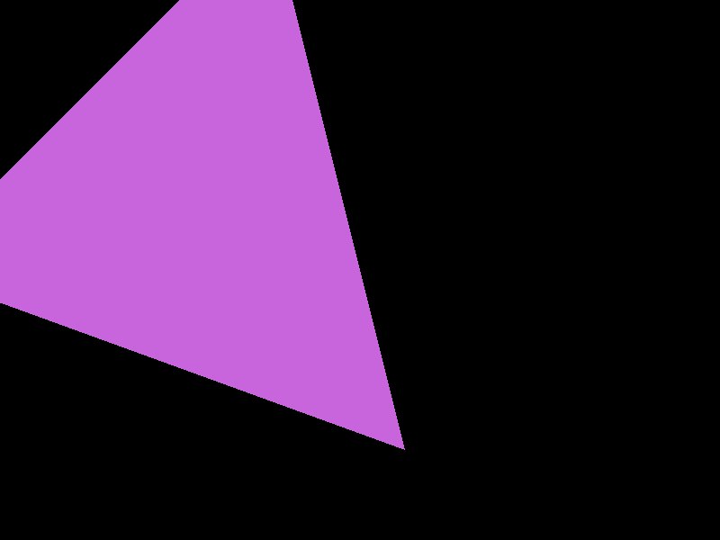

# Lab 5 - Rellenar triángulos

Proyecto en Rust con raylib. La función `rasterize` recibe una lista de triángulos y un `TriangleMode`, y devuelve un `Vec<Fragment>`. Hay tres modos:

- `Wireframe`: tres llamadas a `line` (Bresenham).
- `FilledBarycentric`: relleno con coordenadas baricéntricas.
- `FilledScanline`: relleno por líneas horizontales.

## Cómo correrlo

```
cargo run --release
cargo test --release
cargo run --release -- --save-images
cargo run --release -- --benchmark-triangles
```

En la ventana, las teclas 1, 2 y 3 cambian entre contorno, baricéntrico y líneas horizontales, y las flechas izquierda y derecha cambian de caso de prueba. `--save-images` guarda las imágenes de los 5 casos en tres modos dentro de `images/`, con nombres como `pequeno_y_grande_baricentrico.png` (`contorno`, `baricentrico` y `lineas_horizontales` son los tres modos). `--benchmark-triangles` no abre ventana y solo mide la rasterización; acepta `--iterations N`.

## Algoritmos

**Baricéntricas.** Se calcula el rectángulo más pequeño que contiene al triángulo y se recorre cada píxel. Se evalúa el centro `(x + 0.5, y + 0.5)`, se calculan las tres coordenadas baricéntricas con la función de borde y, si las tres son mayores o iguales a 0, se genera un fragmento. Como se divide entre el área con signo, el orden de los vértices no importa. Si el área es 0 el triángulo se trata como degenerado y no genera fragmentos.

**Líneas horizontales.** Se avanza una fila a la vez evaluando `y + 0.5`. En cada fila se busca dónde cruzan las tres aristas y se toman el extremo izquierdo y el derecho. Se generan fragmentos en los píxeles cuyo centro `x + 0.5` queda entre esos dos extremos. Una arista horizontal solo cuenta si está justo en la fila evaluada, y un vértice que cae en una fila no genera duplicados porque solo se usa el mínimo y el máximo de cada fila.

**Regla de bordes.** Los dos algoritmos usan la misma regla: un punto exactamente sobre un borde cuenta como dentro. Por eso producen las mismas posiciones.

## Imágenes de cada modo

Caso `pequeno_y_grande` (un triángulo pequeño y uno grande):

| Contorno | Baricéntrico | Líneas horizontales |
|---|---|---|
|  |  |  |

Otros casos de prueba:

| Caso | Baricéntrico | Líneas horizontales |
|---|---|---|
| Borde horizontal y borde vertical |  |  |
| Vértices en orden inverso |  |  |
| Parcialmente fuera de la imagen |  |  |

El caso de tres vértices sobre una misma línea no dibuja nada en los modos rellenos, así que no tiene imagen.

## Comprobación de resultados

Se compararon las posiciones `(x, y)` de los fragmentos de ambos algoritmos, no solo la imagen. Salida de `--save-images`:

| Caso | Fragmentos baricéntrico | Fragmentos líneas horizontales | Solo en baricéntrico | Solo en líneas horizontales |
|---|---|---|---|---|
| pequeno_y_grande | 92481 | 92481 | 0 | 0 |
| horizontal_y_vertical | 62650 | 62650 | 0 | 0 |
| orden_inverso | 92275 | 92275 | 0 | 0 |
| parcialmente_fuera | 150200 | 150200 | 0 | 0 |
| colineal | 0 | 0 | 0 | 0 |

Los tests de `cargo test --release` comprueban lo mismo: ambos algoritmos dan las mismas posiciones en los 5 casos, invertir el orden de los vértices da el mismo triángulo y el caso colineal no genera fragmentos.

El triángulo parcialmente fuera de la imagen sí genera fragmentos con coordenadas negativas o mayores al tamaño de la imagen. Esos fragmentos se descartan al dibujarlos en el buffer de la imagen, no al rasterizar.

## Mediciones

Se midió con `cargo run --release -- --benchmark-triangles`, sobre los 7 triángulos de los 5 casos. Cada medición ejecuta `rasterize` 100 veces con `black_box` en la entrada y en el resultado, se repite 7 veces y se toma la mediana. Solo se mide la generación de fragmentos, sin textura ni ventana. El tiempo incluye crear y guardar los fragmentos.

Una corrida:

| Modo | Fragmentos | Mediana de 100 ejecuciones | Por ejecución |
|---|---|---|---|
| Contorno | 6321 | 7.80 ms | 0.078 ms |
| Baricéntrico | 397606 | 658.57 ms | 6.59 ms |
| Líneas horizontales | 397606 | 506.02 ms | 5.06 ms |

Otras dos corridas dieron baricéntrico entre 6.14 y 7.21 ms por ejecución y líneas horizontales entre 4.86 y 6.07 ms. Los números absolutos cambian de una corrida a otra, pero en las tres, líneas horizontales salió más rápido que baricéntrico, entre un 16 % y un 23 % menos de tiempo. El contorno es mucho más rápido porque genera unas 60 veces menos fragmentos, así que su tiempo no se puede comparar con los otros dos en igualdad de trabajo.

Ambos rellenos generan exactamente la misma cantidad de fragmentos, así que la diferencia de tiempo no viene de omitir parte del triángulo.

## Perfil

Se usó `cargo flamegraph -- --benchmark-triangles --iterations 300` (terminal de administrador en Windows). El archivo está en `flamegraph.svg`. Mientras se perfilaba, el benchmark dio 0.0516 ms por ejecución en contorno, 6.2663 ms en baricéntrico y 5.2050 ms en líneas horizontales, o sea que lineas horizontales salió otra vez más rápido (alrededor de un 17 %).

Porcentajes sobre el total de muestras (188046). El ancho de un bloque es la proporción de muestras en que apareció esa función, no el orden de ejecución, y estos porcentajes incluyen a las funciones que llama cada una:

| Función | Porcentaje |
|---|---|
| `rasterize` | 97.7 % |
| `Vec::extend` dentro de `rasterize` (unir los fragmentos de cada triángulo en el `Vec` final) | 49.6 % |
| `triangle_barycentric` | 28.1 % |
| `triangle_scanline` | 19.8 % |

Dentro de `Vec::extend`, el 33.9 % está en `Vec::reserve` (el vector final crece y se reasigna) y cerca de un 10 % en copiar los fragmentos. El contorno casi no aparece porque genera muy pocos fragmentos.

Dentro de cada algoritmo de relleno:

| | `triangle_barycentric` | `triangle_scanline` |
|---|---|---|
| `Vec::push` (crear y guardar fragmentos) | 17.1 % | 17.8 % |
| de eso, crecimiento del `Vec` (`grow_one`) | 12.5 % | 12.1 % |
| función `edge` (cálculo geométrico) | 2.3 % | no aplica |
| iterador del rango | 1.4 % | 1.7 % |
| resto, que es el cálculo propio del bucle | alrededor de 7 % | menos de 1 % |

## Diferencias encontradas

- **Posiciones:** ambos algoritmos generan exactamente las mismas posiciones en los 5 casos, porque usan la misma regla para los bordes (un punto sobre el borde cuenta como dentro). No hubo diferencias que explicar.
- **Tiempo:** líneas horizontales salió entre un 16 % y un 23 % más rápido que baricéntrico en las corridas de medición.
- **Por qué:** el perfil muestra que el relleno baricéntrico gasta alrededor de 7 puntos más en su propio cálculo, ya que evalúa las tres coordenadas baricéntricas en cada píxel del rectángulo que contiene al triángulo, incluso en los píxeles que quedan fuera. Líneas horizontales calcula solo los extremos de cada fila y luego genera fragmentos. Esa es la diferencia entre ambos.
- **Dónde se va el tiempo realmente:** la mayor parte no está en la geometría sino en el manejo del `Vec`. Crear y guardar fragmentos (`push`) es cerca de un 17 % en cada algoritmo, y unir los vectores de cada triángulo con `extend` es cerca de la mitad del total. Los cálculos geométricos pesan poco: `edge` es un 2.3 %.
- **Posible mejora:** reservar capacidad con `Vec::with_capacity` o rasterizar todos los triángulos sobre un único `Vec` evitaría gran parte del crecimiento y las copias. No se implementó porque el lab pide comparar los dos algoritmos tal como están.
